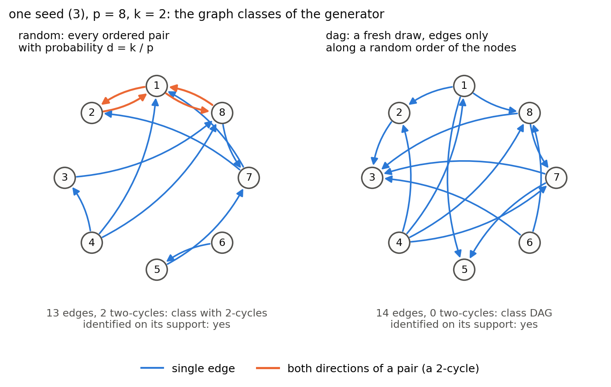
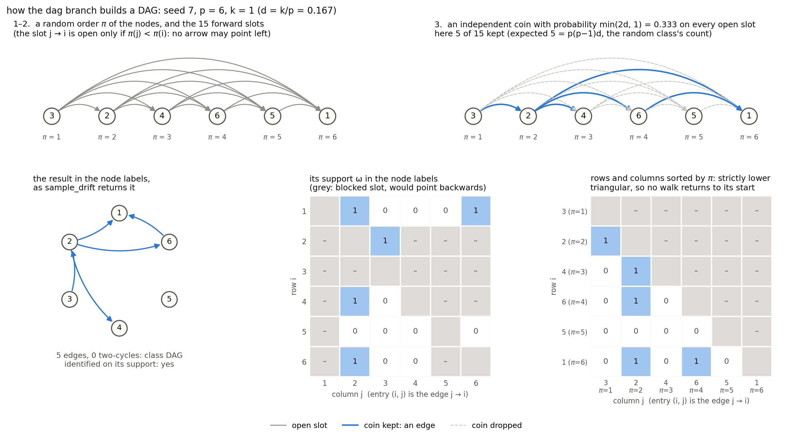
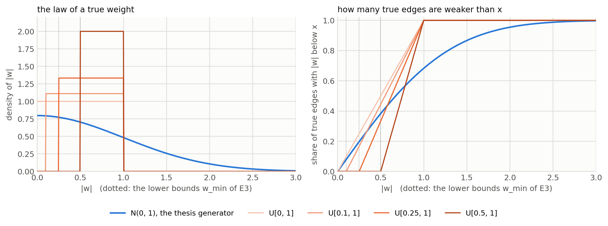
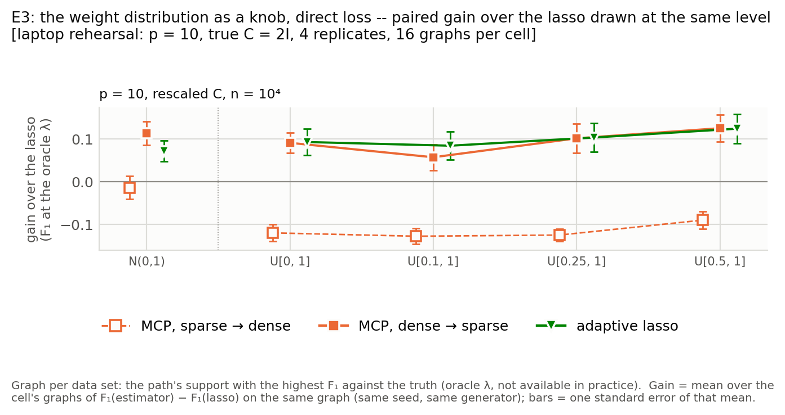
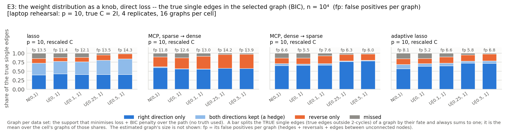
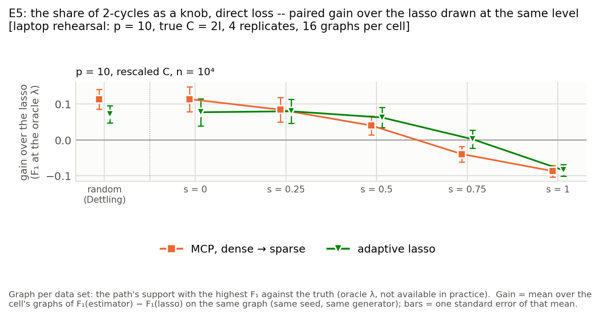
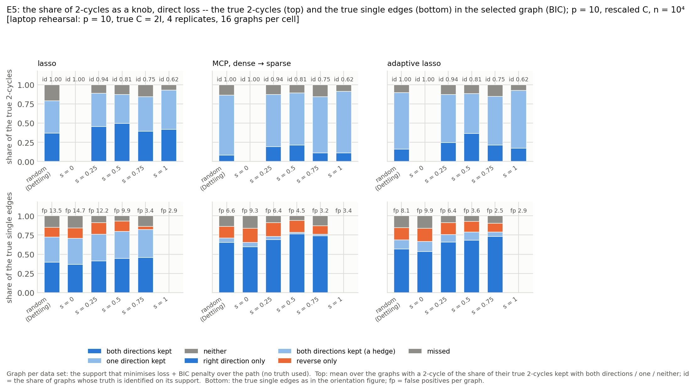

# The generator's knobs: graph class (E4), beta-min (E3) and the share of 2-cycles (E5)

Three knobs on the generator, no new estimator: DAGs (E4), weak edges removed (E3), ever more 2-cycles
(E5). Each asks where the dense → sparse pruners' gain over the lasso lives. Estimators: lasso, MCP dense →
sparse, adaptive lasso; everything else is wave 1's. Status, 19 October 2026: built, tested, rehearsed on
the laptop; nothing submitted.

## 1. Files

```
src/gclm/data/simulate.py        sample_drift(p, d, rng, weights=, w_min=, graph=, two_cycle_share=)   the knobs
src/gclm/config.py               S1Config: weights, w_min, graph, two_cycle_share (defaults = thesis generator)
src/gclm/graphs.py               is_dag, two_cycles, graph_class, identified_on_support
simulations/run_s1_shard.py      --weights --w-min --graph --two-cycle-share --c-choices --select --ebic-gamma
         │   runs/campaign/<cell>/shards/*.npz   (M*, s, λ grid, every support, the seven graphs' counts)
         ▼
simulations/diagnostics/campaign.py        cell name → knob columns; class columns per graph; campaign_per_dataset.csv
   ├── graph_class.py  → plot_graph_class.py        E4   campaign_graph_class.csv, campaign_two_cycles.csv
   ├── betamin.py      → plot_betamin.py            E3   campaign_wmin*.csv, campaign_edge_outcomes.csv   (Knob machinery)
   └── twocycles.py    → plot_twocycles.py          E5   campaign_share*.csv
cluster/submit_campaign.sh  --wave 9 --group class | betamin | twocycle        cluster/plan_131026.txt
simulations/diagnostics/plot_generator_knobs.py → docs/figures/                 this note's illustrations
tests/  test_dgp.py  test_graphs.py  test_campaign_runner.py  test_campaign_submit.py  test_wave9_analysis.py  test_generator_knobs.py
```

## 2. The data-generating process

Per graph, seed `[20260922, p, k, C-index, rep]`, $d = k/p$:

$$M_{ij} = \omega_{ij} w_{ij}\ (i \ne j), \qquad M_{ii} = -\sum_{j \ne i}|M_{ij}| - |\varepsilon_{ii}| \quad\Rightarrow\quad \text{Gershgorin: } \operatorname{Re}\lambda(M) \le -|\varepsilon_{ii}| < 0,\ M \text{ stable}$$

$$C \in \{2I,\ \mathrm{diag}\,U[0.5,4],\ \mathrm{diag}\,U[2,4],\ \text{sparse symmetric, diagonally dominant}\} \qquad (\text{the new groups: } 2I \text{ only})$$

$$M\Sigma + \Sigma M^\top + C = 0 \ \Rightarrow\ \Sigma = \int_0^\infty e^{tM} C e^{tM^\top} dt \quad (\text{Bartels–Stewart, SciPy}); \qquad X_1, \dots, X_n \sim N(0, \Sigma),\ \hat\Sigma = X^\top X / n;\ n = \infty: \hat\Sigma = \Sigma$$

$$s_i = \hat\Sigma_{ii}^{1/2},\quad \hat R = D^{-1}\hat\Sigma D^{-1},\quad \tilde M_{ij} = M_{ij}\, s_j / s_i,\quad \tilde C = 2I\ (\texttt{C2I})\ \text{or}\ 2\,\mathrm{diag}(1/s_i^2)\ (\texttt{Cresc})$$

$$\lambda_j = \lambda_{\max}\,10^{-4(1 - j/99)},\ j = 0..99 \ (\text{log-spaced: a constant factor } 10^{4/99});\qquad \lambda_{\max} = \max_{i \ne j}\bigl|[2(M_{\mathrm{diag}}\hat R + \hat R M_{\mathrm{diag}}^\top + \tilde C)\hat R]_{ij}\bigr|$$

No centring because the mean is known to be zero; divisor $n$ as in Dettling's eq. (1.3).

## 3. The knobs: construction and expected edges

| knob | construction (after the two default draws, so seeds stay untouched) | expected directed edges |
|---|---|---|
| `random` (thesis) | $\omega_{ij} \sim \mathrm{Bern}(d)$ i.i.d. | $p(p-1)d$; a pair is a 2-cycle w.p. $d^2$ |
| `dag` (E4) | $\pi$ a random order; $\omega_{ij} \sim \mathrm{Bern}(\min(2d,1))\cdot\mathbb{1}[\pi(j) < \pi(i)]$ | $\binom{p}{2}\cdot 2d = p(p-1)d$ for $d \le 1/2$ |
| `pairs` (E5) | pair $\{i,j\}$ connected w.p. $q = 2d/(1+s)$; then a 2-cycle w.p. $s$, else one direction by a fair coin | $\binom{p}{2}\,q\,(1+s) = p(p-1)d$; $s = d/(2-d)$ is the random class in law |
| `uniform` weights (E3) | $\lvert w_{ij}\rvert \sim U[w_{\min}, 1]$, sign a fair coin; supports unchanged | unchanged |

A random order gives a DAG because $\pi$ cannot increase around a cycle. The factors $2d$ and $2d/(1+s)$:
half the ordered pairs are open in a DAG; a 2-cycle has two edges.

```python
    if graph == "dag":
        position = rng.permutation(p)                               # position[node] = pi(node)
        allowed = position[None, :] < position[:, None]             # entry (i, j): pi(j) < pi(i)
        omega = rng.binomial(1, min(2.0 * d, 1.0), size=(p, p)) * allowed
    elif graph == "pairs":
        q = min(2.0 * d / (1.0 + two_cycle_share), 1.0)             # P(pair connected): E[edges] = p (p - 1) d
        upper = np.triu(np.ones((p, p), dtype=bool), 1)
        connected = (rng.random(size=(p, p)) < q) & upper
        two = connected & (rng.random(size=(p, p)) < two_cycle_share)
        single_up = (connected & ~two) & (rng.random(size=(p, p)) < 0.5)
        single_down = (connected & ~two) & ~single_up
        omega = np.zeros((p, p), dtype=int)
        omega[two | two.T] = 1
        omega[single_up] = 1                                        # entry (i, j), i < j: the edge j -> i
        omega[single_down.T] = 1
    if weights == "uniform":
        magnitude = rng.uniform(w_min, 1.0, size=(p, p))
        sign = np.where(rng.random(size=(p, p)) < 0.5, -1.0, 1.0)
        values = magnitude if metzler else sign * magnitude
```







*Two classes on one seed; the DAG construction; the weight laws.*

## 4. Seven graphs per data set

$$\text{oracle: } \arg\max_\lambda F_1(S_\lambda, S^*)\qquad \text{selection: } \arg\min_\lambda\ \hat L(S_\lambda) + \log n\,(p + |S_\lambda|)\ [+\,4\gamma|S_\lambda|\log p,\ \gamma \in \{0.5, 1\}]\qquad \text{search: greedy single-edge moves from each selection}$$

$\hat L$ is the refitted loss; at $n = \infty$ the score uses $n := 10^6$. Oracle: uses the truth. Selections: no
truth. Search: the equaliser.

## 5. The cluster runs (wave 9)

| | `class` (E4) | `betamin` (E3) | `twocycle` (E5) |
|---|---|---|---|
| cells | `direct_<est>_<C>_dag_n<n>`: 3 est × 2 C × 1 class × 3 n = **18** | `direct_<est>_<C>_w<wmin>_n<n>`: 3 est × 2 C × 4 laws × 3 n = **72** | `direct_<est>_<C>_s<share>_n<n>`: 3 est × 2 C × 5 shares × 3 n = **90** |
| estimators | lasso, MCP dense → sparse, adaptive lasso (MCP sparse → dense dropped on 19 Oct: its lock-in is wave 1's V1) | the same three | the same three |
| estimator C | `C2I` = 2I, `Cresc` = $2\,\mathrm{diag}(1/s_i^2)$ | the same | the same |
| knob levels | `dag` (the no-2-cycle case is E5's `pairs` at $s = 0$) | $w_{\min} \in \{0, 0.1, 0.25, 0.5\}$, $N(0,1)$ as reference | $s \in \{0, 0.25, 0.5, 0.75, 1\}$, wave 1 as reference `random` |
| p | 10 and 20 in one cell | the same | the same |
| n | $10^3$, $10^4$, $\infty$ | $10^3$, $10^4$, $\infty$ | $10^3$, $10^4$, $\infty$ |
| true C, graphs per cell | all four C: $4k \times 4C \times 25$ reps = 400 per p, **800 per cell** | `C_ID` only: $4k \times 25$ = 100 per p, **200 per cell** (wave 1's 2I graphs, weights redrawn) | `C_ID` only, **200 per cell** |
| per graph | path; oracle; BIC and eBIC(0.5, 1) selections, search from each | the same | the same |
| runner line | `--p 10 20 --reps 25 --select search --ebic-gamma 0.5 1 --c-scale {identity,variance} <est> --graph <class>` | `... --ebic-gamma 0.5 1 --c-choices C_ID ... --weights uniform --w-min W` | `... --ebic-gamma 0.5 1 --c-choices C_ID ... --graph pairs --two-cycle-share S` |
| shards (lasso / MCP-up / adaptive), time | 4 / 16 / 4, 12 h (16 shards, 24 h at $10^3$) | 4 / 16 / 4, 12 h (16 shards, 24 h at $10^3$) | 4 / 16 / 4, 12 h (16 shards, 24 h at $10^3$) |
| cost (LRZ, from wave 1's seconds) | ≈ 105 per n, 115 at $\infty$ (800 graphs per cell) | ≈ 110 per n, 120 at $\infty$ | ≈ 130 per n, 150 at $\infty$ |
| submit | `--group class --n 1e4 \| inf \| 1000 --shards 16 --time 24:00:00` | `--group betamin --n 1e4 \| inf \| 1000 --shards 16 --time 24:00:00` | `--group twocycle --n 1e4 \| inf \| 1000 --shards 16 --time 24:00:00` |
| analysis | `graph_class.py`, `plot_graph_class.py` | `betamin.py --c-choices C_ID`, `plot_betamin.py` | `twocycles.py --c-choices C_ID`, `plot_twocycles.py` |
| rehearsed | 14 and 17 Oct, p = 10, 1 replicate | 19 Oct, p = 10, 2I, 4 replicates (figures below) | 19 Oct, p = 10, 2I, 4 replicates (figures below) |

### Commands, in this order

```bash
# 1. Laptop: stage what the run and its analysis need, test, commit, push
cd ~/Desktop/MastersThesis/repo
git add src/gclm/objective/exact_fits.py src/gclm/solvers/path.py src/gclm/data/simulate.py src/gclm/config.py \
        simulations/run_s1_shard.py cluster/submit_campaign.sh cluster/plan_131026.txt \
        simulations/diagnostics/campaign.py simulations/diagnostics/betamin.py simulations/diagnostics/plot_betamin.py \
        simulations/diagnostics/twocycles.py simulations/diagnostics/plot_twocycles.py \
        simulations/diagnostics/graph_class.py simulations/diagnostics/plot_graph_class.py \
        simulations/diagnostics/starts.py simulations/diagnostics/plot_starts.py simulations/diagnostics/plot_generator_knobs.py \
        simulations/diagnostics/figure5_table.py simulations/diagnostics/plot_figure5.py \
        tests/test_dgp.py tests/test_campaign_runner.py tests/test_campaign_submit.py tests/test_campaign_analysis.py \
        tests/test_wave9_analysis.py tests/test_generator_knobs.py tests/test_figure5_table.py tests/test_plot_figure5.py \
        docs/GRAPH_CLASSES_AND_BETAMIN.md docs/figures docs/REPRODUCTION.md docs/DENSE_START.md docs/FISTA.md \
        docs/LIKELIHOOD.md docs/NONCONVEX.md docs/SEARCH.md README.md next_steps/131026/next_steps_131026.md
python -m pytest -q                      # 533 tests, about 15 min
git commit -m "E3 and E5 on the cluster: every reduction, true C = 2I, n = 1e3, 1e4, inf; the 2-cycle share; generator and cluster notes"
git push

# 2. LRZ: pull, check that the committed tree imports, dry-run
ssh ge47xod3@cool.hpc.lrz.de
cd ~/repo && git pull
module load python 2>/dev/null || module load anaconda3; source ~/venvs/gclm/bin/activate
python -c "import gclm.solvers.path, gclm.objective.exact_fits; print('imports ok')"
bash cluster/submit_campaign.sh --wave 9 --group betamin --n 1e4 --dry-run    # "would submit 192 tasks in 24 cells"
bash cluster/submit_campaign.sh --wave 9 --group twocycle --n 1e4 --dry-run   # "would submit 240 tasks in 30 cells"
bash cluster/submit_campaign.sh --wave 9 --group class --n 1e4 --dry-run      # "would submit 48 tasks in 6 cells"

# 3. LRZ: submit, one line at a time when the queue has room
bash cluster/submit_campaign.sh --wave 9 --group betamin --n 1e4
bash cluster/submit_campaign.sh --wave 9 --group betamin --n inf
bash cluster/submit_campaign.sh --wave 9 --group twocycle --n 1e4
bash cluster/submit_campaign.sh --wave 9 --group twocycle --n inf
bash cluster/submit_campaign.sh --wave 9 --group class --n 1e4
bash cluster/submit_campaign.sh --wave 9 --group class --n inf
bash cluster/submit_campaign.sh --wave 9 --group betamin --n 1000 --shards 16 --time 24:00:00
bash cluster/submit_campaign.sh --wave 9 --group twocycle --n 1000 --shards 16 --time 24:00:00
bash cluster/submit_campaign.sh --wave 9 --group class --n 1000 --shards 16 --time 24:00:00
#    or unattended, in the plan file's order:  nohup bash cluster/feed_queue.sh cluster/plan_131026.txt > logs/feed.out 2>&1 &

# 4. LRZ: look in on it
squeue -M serial -u $USER -h -r | wc -l
bash cluster/submit_campaign.sh --wave 9 --group betamin --n 1e4 --status    # likewise the other groups and n
sacct -M serial -X -u $USER -S now-2days --format=JobName%10,JobID%18,State,Elapsed | grep -v COMPLETED
grep -il "error\|traceback" logs/camp_*.err                                   # must print nothing

# 5. Laptop: bring the cells home and analyse (rerun as cells arrive)
rsync -av ge47xod3@cool.hpc.lrz.de:repo/runs/campaign/ runs/campaign/
python simulations/diagnostics/campaign.py                                    # prints any incomplete cell
python simulations/diagnostics/graph_class.py && python3 simulations/diagnostics/plot_graph_class.py
python simulations/diagnostics/betamin.py --c-choices C_ID && python3 simulations/diagnostics/plot_betamin.py
python simulations/diagnostics/twocycles.py --c-choices C_ID && python3 simulations/diagnostics/plot_twocycles.py
```

## 6. Analysis and figures

```
campaign_per_dataset.csv ─┬─► graph_class.py:  gain within k and class, 2-cycle recovery      → gain_by_class_p<p>, two_cycle_recovery_p<p>
                          ├─► betamin.py:      Knob = level column + row/cell → level + sort/label/select
                          │      knob_table            levels ± se, paired gain over the lasso at the same level, per rule   → gain_by_wmin[_<rule>_f1], levels_by_wmin_n<n>
                          │      orientation_by_knob   per graph: single edges right/hedged/reversed/missed, 2-cycles both/half/neither, fp, identified → orientation_by_wmin_n<n>_<rule>, pair_outcomes_by_wmin_...
                          │      edge_outcomes         per true edge from the shards: |w|, |w| s_j/s_i, fate under every rule        → campaign_edge_outcomes.csv
                          │      binned_orientation    fates by |w| bin within a level (bins 0, .1, .25, .5, .75, 1, 2, ∞)           → orientation_by_weight_..., orientation_bin_across_laws_...
                          └─► twocycles.py:    the same Knob with the share as the level                                                  → gain_by_share, pair_outcomes_by_share_...
```

Fates of a true edge $j \to i$: `correct` ($\hat S_{ij}$ only), `hedged` (both), `reversed` ($\hat S_{ji}$
only), `missed`; a 2-cycle edge is `present` or `missed`. Shares average over graphs; levels are never pooled.









*Previews, p = 10, 2I graphs, 16 graphs per cell.*

| preview, p = 10, rescaled C, n = 10⁴, 16 graphs | N(0,1) | U[0,1] | U[0.1,1] | U[0.25,1] | U[0.5,1] |
|---|---|---|---|---|---|
| lasso oracle F₁ | 0.64 | 0.66 | 0.66 | 0.67 | 0.66 |
| MCP dense → sparse, gain (oracle / selected) | +0.11 / +0.10 | +0.09 / +0.05 | +0.06 / +0.05 | +0.10 / +0.11 | +0.13 / +0.13 |
| adaptive lasso, gain (oracle / selected) | +0.07 / +0.07 | +0.09 / +0.08 | +0.09 / +0.08 | +0.10 / +0.12 | +0.12 / +0.12 |
| lasso: hedged / missed share of single edges | 0.33 / 0.15 | 0.35 / 0.12 | 0.35 / 0.12 | 0.39 / 0.05 | 0.43 / 0.02 |

| preview, same cells | random | s = 0 | 0.25 | 0.5 | 0.75 | 1 |
|---|---|---|---|---|---|---|
| lasso oracle F₁ | 0.64 | 0.61 | 0.67 | 0.71 | 0.74 | 0.75 |
| MCP dense → sparse, gain (oracle / selected) | +0.11 / +0.10 | +0.11 / +0.07 | +0.08 / +0.07 | +0.04 / +0.04 | −0.04 / −0.08 | −0.09 / −0.12 |
| adaptive lasso, gain (oracle / selected) | +0.07 / +0.07 | +0.08 / +0.07 | +0.08 / +0.09 | +0.06 / +0.10 | 0.00 / 0.00 | −0.09 / −0.09 |
| true 2-cycles kept whole: lasso / MCP-up / adaptive | 0.37 / 0.08 / 0.16 | – | 0.46 / 0.20 / 0.25 | 0.50 / 0.21 / 0.37 | 0.40 / 0.11 / 0.21 | 0.42 / 0.11 / 0.17 |
| identified share of graphs | 1.00 | 1.00 | 0.94 | 0.81 | 0.75 | 0.62 |

## 7. Expected outcomes

The gain lives on detected true single edges: a missed edge costs everyone one false negative; a detected
one is where they part, the lasso keeping both directions in a third of the cases, the pruners one. A true
2-cycle reverses the roles.

| knob | pruners (MCP dense → sparse, adaptive) | after the search | would refute §7 |
|---|---|---|---|
| E3, $w_{\min} \uparrow$ | gain grows: rescued edges become hedges for the lasso, correct edges for the pruners; +0.15 → +0.2 at p = 20 | ≈ 0 at $n \ge 10^4$ | lasso hedge share falling with the bound |
| E4, DAG | largest gain, every k: every hedge is a mistake | ≈ 0 | DAGs not gaining more than random within k |
| E5, $s \uparrow$ | gain falls linearly, crosses zero between 0.5 and 0.8 (preview: 0.6 / 0.75) | ≈ 0 except isolated 2-cycles at s = 1 | pruners not losing at s = 1 |

MCP sparse → dense is not run: wave 1 settled its lock-in, and the previews show it flat in both knobs.

At $n = \infty$ E3's curves should be flat with the gain largest; E5's identified share and all oracle
levels fall with $s$.

## References

Dettling, Drton, Kolar (2024) §5; Varando & Hansen (2020) §4; Kalisch & Bühlmann (2007) §4.1; pcalg
`randomDAG`; NOTEARS `simulate_dag`; plan and memo in `../next_steps/131026/`.
