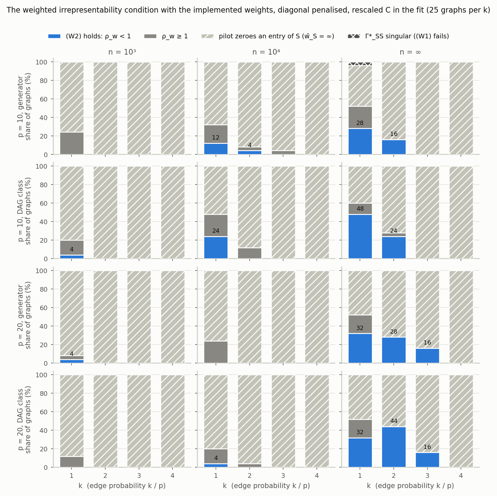
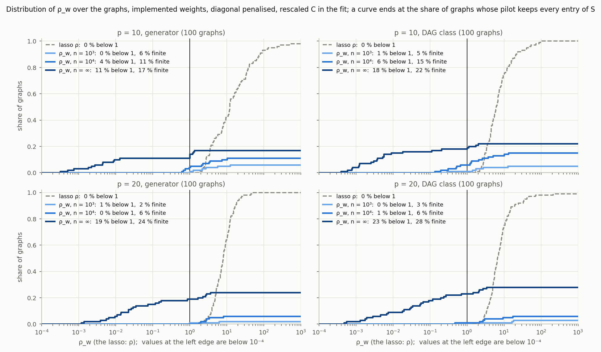
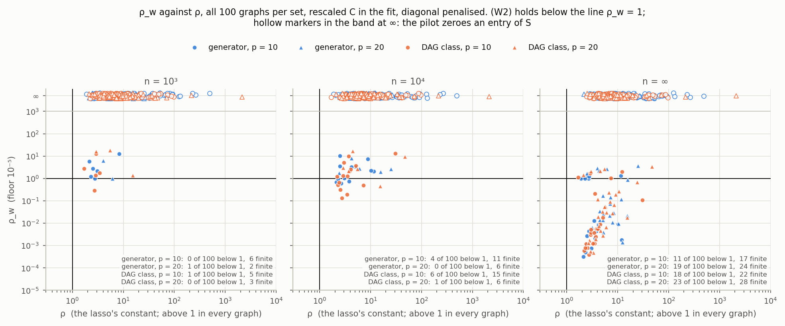
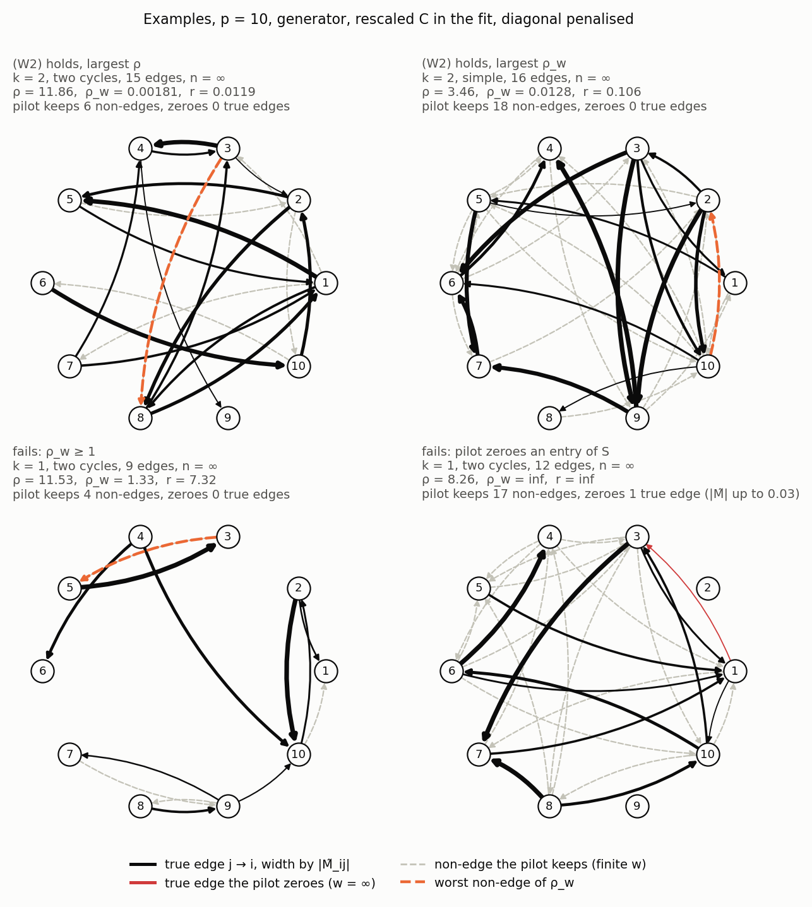
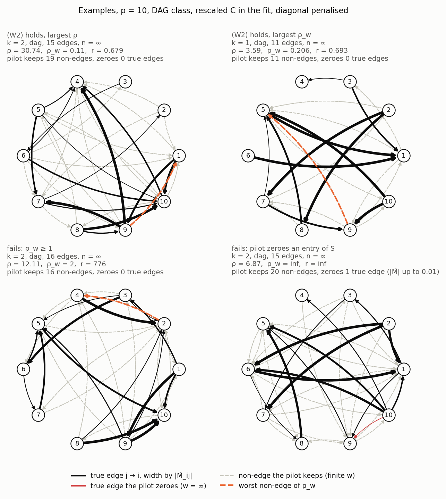

# The weighted irrepresentability condition on the generator's graphs (22 October 2026)

Condition (W2) of [`adaptive_lasso_theorem_211026.md`](../211026/adaptive_lasso_theorem_211026.md), diagonal penalised, implemented weights.

## 1. Setting

Graphs: the campaign's, true $C = 2I$, seeds `[20260922, p, k, 0, rep]`, $k = 1, \dots, 4$, 25 each; `random` = thesis generator, `dag` = `sample_drift(graph="dag")`. Data standardised; $P$ at $R^\ast = \mathrm{corr}(\Sigma^\ast)$, $S$ with the diagonal:

$$
P = \Gamma^\ast_{S^c S}(\Gamma^\ast_{SS})^{-1},\qquad \rho = \max_j \sum_{k \in S} |P_{jk}|,\qquad
\rho_w = \max_{j \in S^c_+} \frac{1}{\hat w_j}\sum_{k \in S} |P_{jk}|\,\hat w_k,\qquad r = \frac{\bar w_S}{\underline w}
$$

Pilot $\hat M^0$: the lasso with the diagonal penalised at $\lambda_{\min} = 10^{-4}\lambda_{\max}$ (`lasso_path(penalize_diagonal=True)`, FISTA $10^{-8}$); $\hat w = \max|\hat M^0| / |\hat M^0|$, $\infty$ at zeros (`adaptive_lasso_path`). $n \in \lbrace 10^3, 10^4, \infty \rbrace$; $C$ in the fit rescaled (`Cresc`, exact) or $2I$ (`C2I`). A zero of $\hat M^0$ on $S$ gives $\bar w_S = \infty$: the theorem does not apply, $\rho_w := \infty$.

```
next_steps/221026/rho_w_study.py      python3 next_steps/221026/rho_w_study.py        results/*.csv, matrices_p<p>.npz  (36 min, 8 cores)
next_steps/221026/plot_rho_w.py       python3 next_steps/221026/plot_rho_w.py         figures/*.png
tests/test_rho_w_study.py             9 tests: unit weights = DDK's constants; rho_w <= rho r; rho_w_sgn = the weighted lasso's dual
results/condition_shares.md           the shares below for both C; every rho_w re-derived from the stored matrices by a second route (22 Oct)
```

## 2. Results

Shares of 100 graphs in %; `keeps S`: no zero of $\hat M^0$ on $S$; last two columns within those (`Cresc`). At $n = 10^3$: (W2) at most 1 %, `keeps S` 2 to 7 %.

| $p$ | graphs | $n$ | (W2) `Cresc` | (W2) `C2I` | `keeps S` | (W2) given `keeps S` | median $\rho_w$ |
|---|---|---|---|---|---|---|---|
| 10 | `random` | $10^4$ | 4 | 1 | 11 | 4/11 | 2.07 |
| 10 | `random` | $\infty$ | 11 | 2 | 18 | 11/18 | 0.009 |
| 10 | `dag` | $10^4$ | 6 | 0 | 15 | 6/15 | 1.26 |
| 10 | `dag` | $\infty$ | 18 | 1 | 22 | 18/22 | 0.005 |
| 20 | `random` | $10^4$ | 0 | 0 | 6 | 0/6 | 2.74 |
| 20 | `random` | $\infty$ | 19 | 0 | 24 | 19/24 | 0.028 |
| 20 | `dag` | $10^4$ | 1 | 0 | 6 | 1/6 | 2.83 |
| 20 | `dag` | $\infty$ | 23 | 0 | 28 | 23/28 | 0.043 |







## 3. Examples ($p = 10$, `Cresc`)





## 4. Reading

- The lasso's constants never hold: $\rho \ge 1.7$ in all 400 graphs (medians 6 to 12), weak constant $\ge 1.03$; two `random` graphs have $\Gamma^\ast_{SS}$ singular (isolated 2-cycle).
- The theorem's standing assumption fails first: the dense end zeroes true edges in 72 to 98 % of the graphs, median 2 to 10, the largest with $|\tilde M_{ij}| \approx 1$. Not a beta-min effect: the BP failure of 14 October. The pilot keeps about $p(p-1)/2$ off-diagonal entries.
- Where the pilot keeps $S$ at $n = \infty$ with the exact $C$: $\rho_w \lt 1$ in 72 to 81 %, median $\rho_w$ 0.005 to 0.04, $r$ 0.06 to 0.4, although $\rho \gg 1$. At finite $n$ the kept non-edges are not small ($r$ 9 to 30), median $\rho_w$ 1.3 to 6.
- `dag` above `random`; $k = 4$ never; $C = 2I$ in the fit at most 2 %; Corollary W.4 adds 2 to 4 points; the worst non-edge is the reverse of a true edge in 70 to 100 % of the finite failures.
- Next: a pilot without zeros (a floor on the weights, or the minimum-$\ell_2$ exact fit); Corollary W.3 needs $\lVert \hat M^0 - M^\ast \rVert_\infty \lt \beta_{\min} / (1 + \rho)$.
