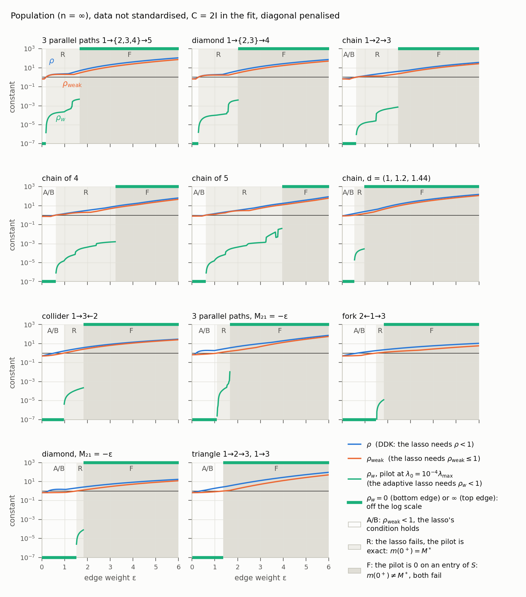

# Part 1 graphs: $\rho$, $\rho_{\mathrm{weak}}$, $\rho_w$ and the pilot, at $n=\infty$ and finite $n$ (29 October 2026)

The graphs of [step 2, Part 1](../261026/step2_261026.md), every entry of $M$ penalised (diagonal included). The main
table: **data not standardised**, true and fitted $C=2I$; the standardised version, as in the campaign, in the last
section. How the data were generated:
[data_generation_291026.md](data_generation_291026.md); how to read the figures: [README](README.md).

## Graphs

Eleven small DAGs with $M^\ast=-\mathrm{diag}(d)+\varepsilon B$, one weight $\varepsilon$ on every edge and $d_t\lt d_h$ on every edge $t\to h$
(parent $t$, child $h$): pictures, rates and drift matrices in [graphs_291026.md](graphs_291026.md).

## Conditions

$S=\mathrm{supp}(M^\ast)$ with the diagonal, $\mathrm{sign}(M^\ast_{ii})=-1$, $P=\Gamma^\ast_{S^cS}(\Gamma^\ast_{SS})^{-1}$:

$$
\rho=\max_{j\in S^c}\sum_{k\in S}\lvert P_{jk}\rvert,\qquad \rho_{\mathrm{weak}}=\lVert P\,\mathrm{sign}(m^\ast_S)\rVert_\infty,\qquad
\rho_w=\max_{j\in S^c,\ \hat w_j\lt\infty}\ \frac{1}{\hat w_j}\sum_{k\in S}\lvert P_{jk}\rvert\,\hat w_k .
$$

Weights as implemented: pilot $\hat M^0$ = the lasso at $\lambda_0=10^{-4}\lambda_{\max}$, $\hat w=\max\lvert\hat M^0\rvert/\lvert\hat M^0\rvert$,
$\hat w=\infty$ where $\hat M^0=0$; $\rho_w=\infty$ if $\hat M^0$ is $0$ on $S$. $m(0^+)$ is the minimum-$\ell_1$ exact fit,
the pilot's limit as $\lambda_0\to0$.

## Population: $n=\infty$, $\varepsilon=0.02,0.04,\dots,6$

Largest $\varepsilon$ up to which each condition holds; it fails at every larger $\varepsilon$.

| graph | $\rho\lt1$ | $\rho_{\mathrm{weak}}\lt1$ | $\rho_w\lt1$ | $m(0^+)=m^\ast$ | $\max\rho_w$ in R |
|---|---|---|---|---|---|
| paths $1\to\lbrace2,3,4\rbrace\to5$ | $0.16$ | $0.16$ | $1.64$ | $1.64$ | $0.005$ |
| diamond $1\to\lbrace2,3\rbrace\to4$ | $0.26$ | $0.26$ | $2.02$ | $2.02$ | $0.004$ |
| chain $1\to2\to3$ | $0.58$ | $0.60$ | $2.44$ | $2.44$ | $0.0007$ |
| chain $1\to\dots\to4$ | $0.56$ | $0.60$ | $3.22$ | $3.22$ | $0.002$ |
| chain $1\to\dots\to5$ | $0.56$ | $0.60$ | $3.94$ | $3.94$ | $0.04$ |
| chain, $d=(1,1.2,1.44)$ | $0.16$ | $0.52$ | $0.96$ | $0.96$ | $0.0003$ |
| collider $1\to3\leftarrow2$ | $0.52$ | $0.96$ | $1.82$ | $1.82$ | $0.0002$ |
| paths, $M_{21}=-\varepsilon$ | $0.16$ | $1.08$ | $1.66$ | $1.66$ | $0.01$ |
| fork $2\leftarrow1\to3$ | $0.66$ | $1.48$ | $1.82$ | $1.82$ | $1.2\cdot10^{-5}$ |
| diamond, $M_{21}=-\varepsilon$ | $0.28$ | $1.50$ | $1.82$ | $1.82$ | $8\cdot10^{-5}$ |
| triangle | $0.34$ | $1.36$ | $1.36$ | $1.36$ | no R |



- $\rho_w\lt1$ exactly where $m(0^+)=m^\ast$, at all 3,300 points, and there $t^\ast>0$: (W2) holds in classes A, B and R.
- A and B: $\hat M^0$ has support $S$, $\rho_w=0$. R: $\hat M^0$ keeps 1 to 6 non-edges, each below $70\lambda_0$, so
  $\rho_w\propto\lambda_0$. F: $\hat M^0$ and $m(0^+)$ are zero on an entry of $S$, almost always a true edge
  ([m0_vs_mstar_291026.md](m0_vs_mstar_291026.md)), so $\rho_w=\infty$.
- $\lambda_0=10^{-3}\lambda_{\max}$ gives the same column. With $10^{-2}\lambda_{\max}$, $\rho_w$ reaches $1$ before F in two graphs
  (chain of 5 from $3.48$, paths with $M_{21}=-\varepsilon$ at $1.66$).


## Standardised or not

The campaign and the (W2) study of 22 October (slides of 28 October, F4–F6) standardise the data and fit with
$C=2D^{-2}$. Largest $\varepsilon$ up to which each condition holds, not standardised / standardised ($n=\infty$):

| graph | $\rho\lt1$ | $\rho_{\mathrm{weak}}\lt1$ | $m(0^+)=m^\ast$ |
|---|---|---|---|
| paths $1\to\lbrace2,3,4\rbrace\to5$ | $0.16$ / never | $0.16$ / $0.48$ | $1.64$ / all |
| diamond $1\to\lbrace2,3\rbrace\to4$ | $0.26$ / never | $0.26$ / $0.62$ | $2.02$ / all |
| chain $1\to2\to3$ | $0.58$ / never | $0.60$ / never | $2.44$ / $1.72$, $1.80$ to $6$ |
| chain $1\to\dots\to4$ | $0.56$ / never | $0.60$ / never | $3.22$ / all |
| chain $1\to\dots\to5$ | $0.56$ / never | $0.60$ / never | $3.94$ / all |
| chain, $d=(1,1.2,1.44)$ | $0.16$ / never | $0.52$ / never | $0.96$ / all |
| collider $1\to3\leftarrow2$ | $0.52$ / never | $0.96$ / never | $1.82$ / all |
| paths, $M_{21}=-\varepsilon$ | $0.16$ / never | $1.08$ / never | $1.66$ / $1.10$ |
| fork $2\leftarrow1\to3$ | $0.66$ / never | $1.48$ / $0.74$, $2.02$ to $2.10$ | $1.82$ / $2.44$ |
| diamond, $M_{21}=-\varepsilon$ | $0.28$ / never | $1.50$ / never | $1.82$ / $0.74$ |
| triangle | $0.34$ / never | $1.36$ / $0.26$ | $1.36$ / $0.26$ |

Standardised, $\Sigma=\mathrm{corr}(\Sigma^\ast)\approx I$ near the diagonal, so the rates $d_i$ no longer favour the true direction:
$\rho_{\mathrm{weak}}\to1$ and $t^\ast\to0$ as $\varepsilon\to0$, and $\rho\lt1$ nowhere. $m(0^+)=m^\ast$ holds more widely, but with a small
margin ($t^\ast\approx0.002$ for the chains up to $\varepsilon=2$, against $0.16$ to $0.40$ unstandardised).

Standardised, $\rho_w\lt1$ again holds exactly where $m(0^+)=m^\ast$, except in the chain of 5 above $\varepsilon=5.30$: there
$t^\ast\approx0.02$, and the pilot at $10^{-4}\lambda_{\max}$ is still far from its limit. Figures: both scales in
`figures/population_conditions.png`, the constants in `figures/corr/` as in `figures/cov/`.


## Finite $n$

Results and figure in [finite_n_291026.md](finite_n_291026.md).

## Code and tests

```text
part1_population.py   n = inf: results/part1_population.csv, part1_pilots.csv, part1_intervals.csv
part1_finite_n.py     finite n: results/finite_n_reps.csv, finite_n_summary.csv
plot_part1.py         figures/
tests/test_part1_population.py, tests/test_part1_finite_n.py   (31 tests)
```
